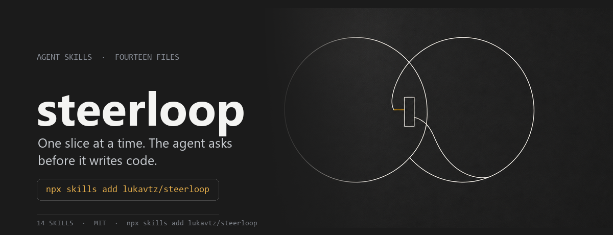
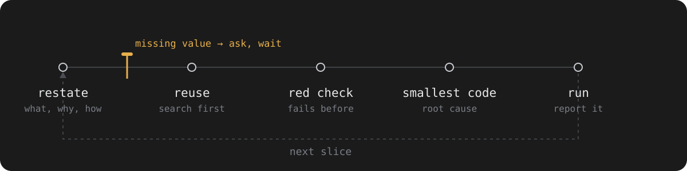

<p align="center">
  
</p>

<p align="center">
  <a href="#install">Install</a> ·
  <a href="#the-gate">The gate</a> ·
  <a href="#the-skills">The skills</a> ·
  <a href="#evidence">Evidence</a> ·
  <a href="#limits">Limits</a>
</p>

One commit gate and two skill files for coding agents.

The gate is the part that cannot be ignored: it rejects a commit or a pull request whose message does not carry the five-key slice report. The skills describe how to produce one.

```
changed: parser.mjs, parser.test.mjs
verified: node --test parser.test.mjs → 4 pass, 0 fail
assuming: none
not done: none
question: none
```

## Install

Skills, into any agent that reads `SKILL.md`:

```bash
npx skills add lukavtz/steerloop
```

Gate, in the repository you want to police:

```bash
git config core.hooksPath .githooks   # from a clone of this repo
```

or copy `gate/steerloop-gate.mjs` into your own tooling and call it from a `commit-msg` hook or CI step.

## The gate

| Check | Rejects |
| --- | --- |
| All five keys present | a message without `assuming:` |
| Every value non-empty | `question:` with nothing after it |
| `verified:` names something runnable | `verified: looked right` |
| Merge commits and `[skip-gate]` | nothing — they pass |

`STEERLOOP_SKIP=1` bypasses while it is set, for the case where the gate itself is wrong. The 26 tests behind it live in [`gate/steerloop-gate.test.mjs`](./gate/steerloop-gate.test.mjs) and run with `npm test`.

```bash
npm test          # the gate's own tests
npm run gate:check -- pr-body.md
```

## The skills

| Skill | Owns | Fires when |
| --- | --- | --- |
| **`steerloop`** | Interaction gates: when to stop, what a slice is, what the report contains | Every coding task, at the start |
| **`craftloop`** | Engineering depth: spec, architecture, security, verification, git and PR delivery | Substantial work |

`craftloop` is vendored here with two sentences changed: an unanswered gate counts as a blocker, and a value the request does not state is the user's decision rather than a default to invent.

## How it works

<p align="center">
  
</p>

A blocked slice reports like this:

```text
changed: none
verified: `cat store.mjs` → 5 lines, no importer of saveUser
assuming: none
not done: all of it — blocked on the values below
question: TTL, storage, error policy, invalidation, rollout?
```

The report is the part that survives contact with git. Everything else in the skill is advice the model may ignore; this block is checked.

## Evidence

Two instruments in [`evals/`](./evals), both A/B on the same harness, so the only variable is the skill text.

**Behaviour probes** — 9 baited tasks, 5 repetitions per cell, 45 cells per arm:

| Arm | Passed |
| --- | ---: |
| Plain prompt | 26 / 45 |
| With `steerloop` | 38 / 45 |

Almost all of that gap sits in one rule. On the two tasks that need values the request never states, the skill arm disclosed or blocked 10 of 10 times; the plain arm 0 of 10:

| Cache and no-answer tasks | Blocked | Declared the assumptions |
| --- | ---: | ---: |
| Plain prompt | 0 / 10 | 0 / 10 |
| With `steerloop` | 2 / 10 | 8 / 10 |

The other seven probes, which do not depend on that field, split 28 / 35 against 26 / 35. The skill changed one thing: default values now appear in the report instead of vanishing into the code.

**SlopCodeBench-lite** — three CLI tasks, three rounds each, the agent extends its own code while the spec grows. Design and metrics follow [SlopCodeBench](https://arxiv.org/abs/2603.24755). Two repetitions, 26 checkpoints per arm:

| Metric | Plain | `steerloop` |
| --- | ---: | ---: |
| Checkpoints passed | 26 / 26 | 26 / 26 |
| Production LOC | 76 | 64 |
| All code LOC | 85 | 82 |
| Erosion (largest function ÷ LOC) | 0.17 | 0.12 |

The size difference traces to one wording change. With the earlier rule, "write a check first" produced a new `check.mjs` per slice and the skill arm ran 47% larger. Reworded to "a command you rerun, not a new file", the same tasks came out smaller than the control. Treat the direction as a lead, not a finding: six cells per arm, and earlier runs disagreed.

Reproduce (requires an omp session: the runners call the `agent`/`wait` helpers that the eval kernel injects into `__main__`):

```bash
%load "evals/run_evals.py"    # probe suite; main(reps=5) in the eval kernel
await main()                  # in evals/run_slop.py, the slop benchmark
```

The per-cell checks behind both tables are committed: [`evals/results/2026-11-04-probes.json`](./evals/results/2026-11-04-probes.json) and [`evals/results/2026-11-04-slop.json`](./evals/results/2026-11-04-slop.json). `REPS` is 5, matching the table. Rerunning overwrites the working copies; the dated artifacts stay.

## Limits

- **Prose does not enforce.** The only measured effect of the skill text is the check-file wording. Every other rule was followed at the rate of the control arm.
- **The gate enforces format, not thought.** It can verify that a `verified:` line exists and looks like a command. It cannot verify that the command was run or that the output was real. That is the honest ceiling of a hook.
- **One harness, one model family.** Every number comes from a setup whose system prompt already enforces verification. On a bare agent the delta could differ in either direction.
- **The assumption field discloses, it does not stop.** With the skill present, 8 of 10 runs shipped the guessed values anyway and 2 blocked. That is better than silence, and it is not the behaviour the skill asks for.
- **The gate cannot tell a declared assumption from an honest one.** `assuming: none` passes whether or not the agent guessed. Presence is checkable; truth is not.

## Layout

```text
skills/steerloop/SKILL.md    the contract
skills/craftloop/SKILL.md    the method
skills/craftloop/references/ security rules, loaded on demand
gate/steerloop-gate.mjs      the report validator
gate/steerloop-gate.test.mjs 26 tests, run by npm test
.githooks/commit-msg         hook that calls the validator
evals/                       probes and the slop benchmark
evals/results/               committed per-cell checks
assets/readme/               hero, loop diagram, social card, build script
```

`assets/readme/social.png` is the 1200×630 card for the repository's social preview.

## License

MIT.
